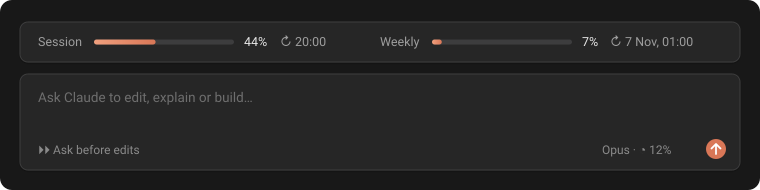

<div align="center">

# Quota Gauge for Claude Code

**See how much of your Claude plan you've used, right above the prompt.**
No more typing `/usage`, no more surprise "limit reached" in the middle of a task.

[](https://github.com/maxsld/claude-quota-gauge/actions/workflows/check.yml)


[](LICENSE)



</div>

## Features

- **Session and weekly bars.** Your rolling 5-hour window and your 7-day window, as percent used, right above the prompt box.
- **Reset times.** `↻ 20:00` when it resets today, `↻ 7 Nov, 01:00` otherwise, in your own locale.
- **Alerts.** A notification when a window reaches your warning level (80% by default) and again at 95%. Each alert fires once per window.
- **Red when it matters.** Bars are Claude orange and turn red past your warning level.
- **Works everywhere.** In the Claude Code VS Code extension and in the terminal.
- **Instant.** The bars are there as soon as you open Claude Code, no message needed.
- **Light and private.** No tokens spent, and the plugin never sees your login: Claude Code makes the one request for it.

## Install

Installs once for your user account, so the gauge is there in **every project**, existing and new.

**From a terminal** (one line):

```bash
claude plugin install quota-gauge --marketplace maxsld/claude-quota-gauge --scope user
```

**Or inside Claude Code**, type:

```
/plugin install quota-gauge --marketplace maxsld/claude-quota-gauge
```

Answer `y` to add the marketplace, then keep the **User** scope (the default, press Enter) so it applies to all your projects.

**In the VS Code extension**, if `/plugin` isn't available: click **+** next to the prompt box, then **Plugins** → **Add marketplace** with `maxsld/claude-quota-gauge`, then **Add plugin** and pick the **User** scope.

The gauge appears right away. To get new versions: `/plugin update quota-gauge`.

### Requirements

- **Claude Code 2.1.314** or newer (VS Code extension or CLI)
- A **claude.ai Pro, Max or Ultra** subscription. Usage windows only exist for subscription plans: with an API key there is nothing to show.

## Settings

You can set these when you install, and change them any time in `/config` (the **quota-gauge** rows). Changes apply immediately.

| Setting | Default | What it does |
| --- | --- | --- |
| Bars to show | Session and weekly | Show both bars, or only one |
| Warning level (%) | 80 | Bars turn red and the first alert fires at this usage |
| Usage alerts | On | Notify at the warning level and at 95% |
| Time format | 24-hour | 24-hour, 12-hour or your system's format |

## How it works

- **When a session opens**, the plugin asks Anthropic for your account's usage, the same request `/usage` makes, so the bars fill in right away. It goes through Claude Code's own login (`$.session.authorize()`): the plugin never sees your token.
- **After every reply**, Claude Code reports your usage with the response, and the bars follow it live.
- **While you're idle**, usage is read again every 5 minutes, so use from another device or conversation shows up too, and a window that just reset drops back to 0%.
- The last reading is kept locally, so the bars are filled even before the first request answers.

## FAQ

**A bar shows `–%`.**
Its figure hasn't been read yet, usually for a second while the session opens. If it stays, you're probably signed in with an API key rather than a Pro, Max or Ultra plan: usage windows only exist for subscriptions.

**There's a small "From quota-gauge plugin" label above the bars.**
Claude Code adds it to everything a plugin draws, so you always know what's showing what. Plugins can't remove it.

**Does it count only this conversation?**
No. The figures are for your whole Claude account, the same as `/usage`: every conversation, on every device.

**Is my data sent anywhere?**
Nothing leaves your machine except one request to Anthropic's own API (`api.anthropic.com`), the same one `/usage` makes, every 5 minutes at most. It's sent by Claude Code with your existing login; the plugin never handles the token. Nothing is sent anywhere else.

## Uninstall

```
/plugin uninstall quota-gauge
```

## Development

```bash
git clone https://github.com/maxsld/claude-quota-gauge
cd claude-quota-gauge
claude plugin validate .   # manifest and hooks
claude plugin test .       # unit and render tests
claude --plugin-dir .      # try your changes live
```

The plugin is three small files: [hooks/gauge.ts](hooks/gauge.ts) (readings, alerts, time format), [hooks/register.tsx](hooks/register.tsx) (Claude Code hooks and the drawing) and [types/index.d.ts](types/index.d.ts) (the state it keeps). Pull requests are welcome.

## En français

**Quota Gauge** affiche ta consommation Claude (session de 5 h et semaine) juste au-dessus du champ de saisie de Claude Code, avec l'heure de réinitialisation et une alerte à 80 % et 95 %. Installation, une seule fois pour tous tes projets : `claude plugin install quota-gauge --marketplace maxsld/claude-quota-gauge --scope user` dans un terminal, ou `/plugin install quota-gauge --marketplace maxsld/claude-quota-gauge` dans Claude Code (garde la portée **User**). Nécessite un abonnement Pro, Max ou Ultra.

## License

[MIT](LICENSE) © Maxens Soldan

<sub>Not affiliated with or endorsed by Anthropic. Claude and Claude Code are trademarks of Anthropic.</sub>
